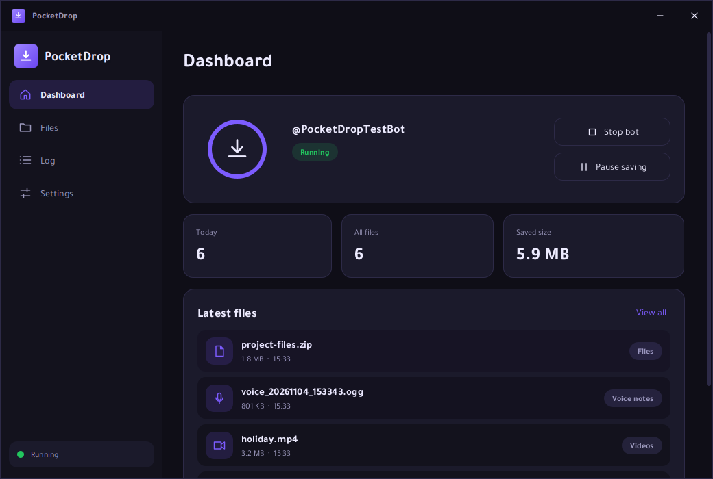
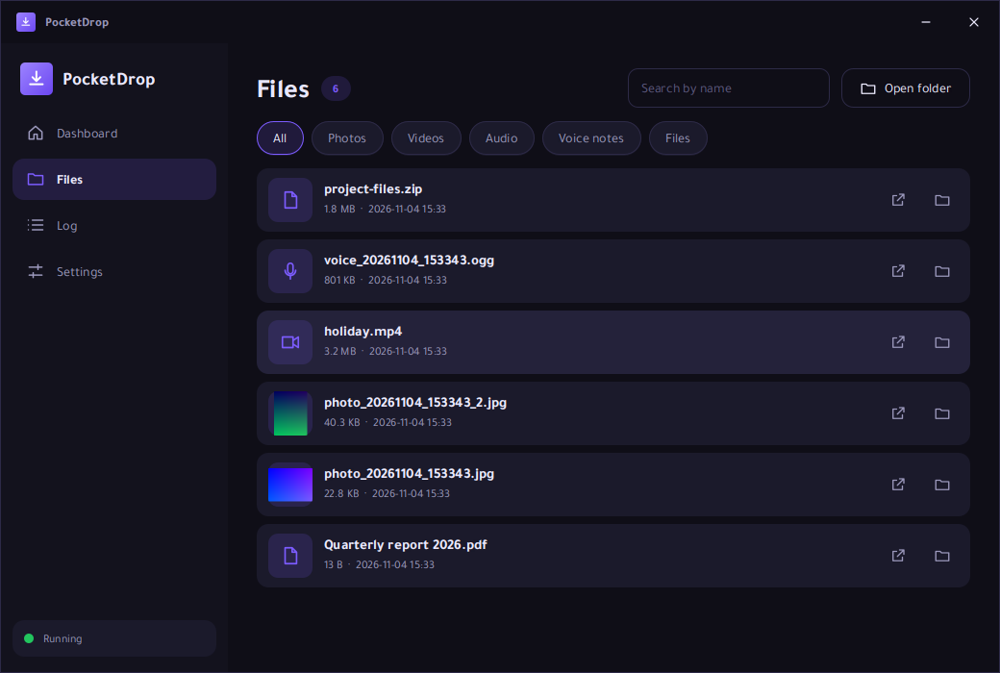
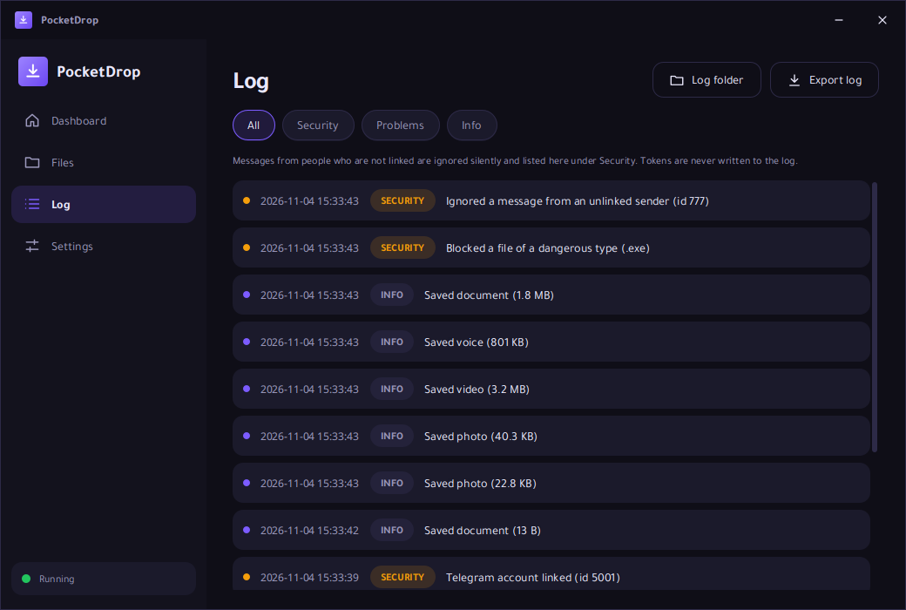
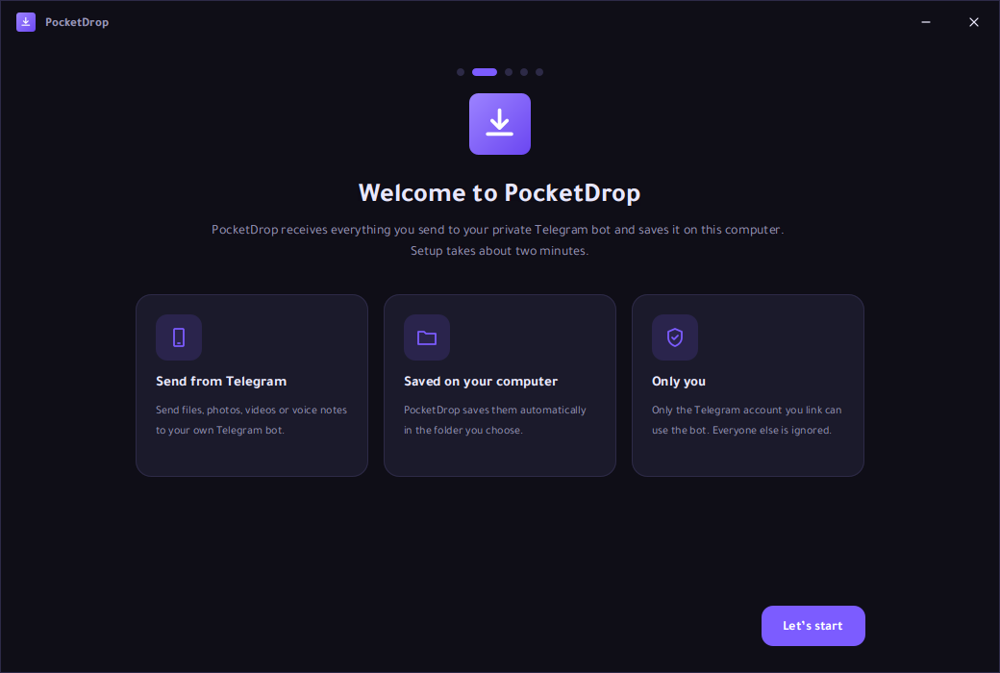
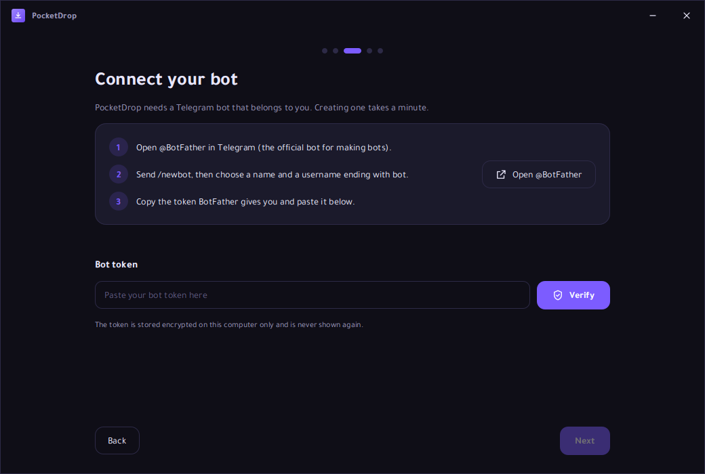
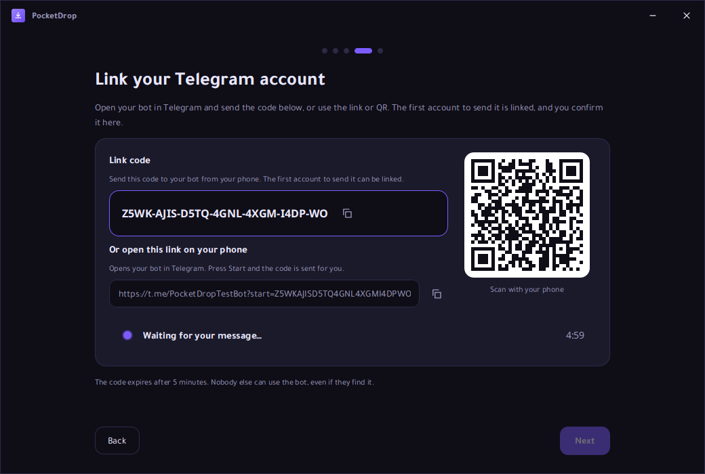

<div align="center">


# PocketDrop

**A private drop box for everything you send to your own Telegram bot.**

PocketDrop is a Windows desktop application I built that automatically saves every file you send
to your personal Telegram bot — documents, photos, videos, audio and voice messages —
directly to your own computer.

[](#installation)
[](#building-from-source)
[](#building-from-source)
[](#running-the-tests)
[](LICENSE)
[](../../releases)

</div>

---

> **Status: early alpha (`v0.1.0-alpha`).** The core flow — pairing your bot, saving and
> browsing files — works end to end, but the project is young. Expect rough edges, and
> please [open an issue](../../issues) if anything breaks.

## Overview

PocketDrop turns a private Telegram bot into a small, personal drop box. You send a file
to your bot from any device — phone, tablet, another computer — and PocketDrop, running on
your Windows machine, receives it and stores it in an organized folder structure.
I built it around one rule: nothing is uploaded to a third-party cloud — the destination
is your own disk, and the only server PocketDrop ever talks to is Telegram's.

The application is built with JavaFX and ships with a dark theme, full Arabic/English
localization, a system-tray mode, and a first-run wizard that walks you through creating
a bot and linking your account. The installer bundles its own Java runtime, so end users
install one `.exe` and need nothing else.

## Features

- **Automatic saving** — documents, images, videos, audio and voice messages sent to your
  bot are saved to your computer as they arrive.
- **Private by design** — the bot answers only to the account you link during setup;
  messages from strangers are silently ignored and logged.
- **First-run wizard** — step-by-step linking with a one-time pairing code (130-bit random,
  valid for 5 minutes) and an explicit "Is this you?" confirmation dialog.
- **Organized storage** — files are renamed safely (no path tricks, no hidden
  direction characters, no Windows reserved names) and are never overwritten; the app
  keeps a history of everything it saved.
- **Safe by default** — dangerous file types (`.exe`, `.bat`, `.js`, …) are rejected unless
  you explicitly enable them in Settings after a warning.
- **Missed messages are not lost** — if PocketDrop is closed, Telegram holds your files for
  roughly 24 hours and they are saved on the next launch.
- **Localizable UI** — full Arabic and English interfaces, dark theme, Tajawal font (OFL license).
- **Convenient** — system-tray operation and an optional start-with-Windows setting.

## Screenshots

The main window — dashboard, saved files and the activity log:

| Dashboard | Files | Log |
|:---:|:---:|:---:|
|  |  |  |

The first-run wizard — from install to a linked bot in about two minutes:

| Welcome | Connect your bot | Link your account |
|:---:|:---:|:---:|
|  |  |  |

*(Screenshots show the English interface; the app also ships a full Arabic, right-to-left interface.)*

## Installation

1. Download `PocketDrop-<version>.exe` from the
   [**Releases**](../../releases) page.
2. Run it. The installer is **per-user** — it needs no administrator rights and installs
   no extra dependencies (the Java runtime is bundled inside).
3. Launch PocketDrop and follow the first-run wizard (see
   [Getting started](#getting-started)).

> **Note on SmartScreen:** unless the installer is signed with a widely trusted
> certificate, Windows may show a *"Windows protected your PC"* notice on first run.
> This is expected for unsigned and self-signed free software — click *More info →
> Run anyway*. See [Code signing](#code-signing) for details.

## Getting started

1. **Create a bot** — in Telegram, open [@BotFather](https://t.me/BotFather), send
   `/newbot` and follow the prompts. BotFather gives you a **bot token**.
2. **Enter the token** — PocketDrop's wizard asks for it once. The token is encrypted
   with your Windows account (DPAPI) and stored locally in `%APPDATA%\PocketDrop`.
3. **Link your account** — the app shows a one-time pairing code, valid for five minutes.
   Send it to your bot from your own Telegram account and confirm the *"Is this you?"*
   dialog. From then on, anything you send to the bot is saved on this computer.

Your bot token is a secret — anyone who has it controls your bot. It never leaves your
machine (encrypted at rest), is never written to logs or error messages, and can be
revoked at any time via @BotFather (`/revoke`).

## How it works

PocketDrop is a JavaFX desktop application that communicates with the Telegram Bot API
over HTTPS. I wrote **my own minimal client** (`TelegramApi.java` + `HttpGateway.java`,
roughly 300 lines) instead of using a third-party Telegram library, for two reasons:

- The only external dependency of the whole project is **JavaFX**. Fewer dependencies
  mean a smaller supply chain to audit.
- The client validates TLS certificates and hostnames, does **not** follow redirects,
  accepts only `api.telegram.org` as the endpoint, sanitizes file paths, and never
  includes the bot token in error messages. (The commonly used `telegrambots` library
  was found to disable hostname verification — with the token embedded in every request
  URL, that was an unacceptable trade-off.)

Incoming updates are processed by the `bot` package, stored by the `storage` package
(safe naming, atomic writes, history), and presented by the `ui` package
(dashboard, files, log and settings pages around a small page shell).

## Security and privacy

| Aspect | Behavior |
|---|---|
| Secrets in code | None. No token or chat ID is stored in the repository or the binary. |
| Token at rest | Encrypted per Windows user via DPAPI (`config.json` in `%APPDATA%\PocketDrop`). |
| Token in logs | Redacted; logs never contain the token. |
| Strangers | Silently ignored and recorded in the log. |
| Pairing | 130-bit random code, valid 5 minutes, with an explicit confirmation dialog. |
| File names | Cleaned of path components, hidden bidirectional characters and reserved device names. |
| Executable files | `.exe`, `.bat`, `.js`, … are refused unless explicitly enabled with a warning. |
| Writes | Atomic (temporary file then rename) and never overwrite an existing file. |
| Network | The only outbound connection is to Telegram's servers. |
| Supply chain | One dependency (JavaFX); the Telegram client is small enough to read in one sitting. |

I kept `TelegramApi.java` and `HttpGateway.java` deliberately small so that independent
review is easy — and it is genuinely welcome.

## Building from source

**Prerequisites:** JDK 21 or newer, Maven 3.9+, an internet connection for the first
dependency download. (JavaFX 24 needs a JDK 22+ runtime; if you build on JDK 21, set
`<javafx.version>` in `pom.xml` to `21.0.5`.)

```powershell
git clone https://github.com/<your-username>/PocketDrop.git
cd PocketDrop

# Run the application
mvn javafx:run

# Build the jar
mvn package
```

### Running the tests

```powershell
powershell -ExecutionPolicy Bypass -File scripts\run-tests.ps1
```

The suite runs the bot **completely offline** against a mock Telegram server
(`FakeTelegram`): pairing, saving, stranger rejection, file-name sanitization, commands,
albums, security checks (certificate validation, redirect behavior, token leakage,
path safety) and more.

An optional `ProductionPathCheck` (requires administrator privileges, skipped
automatically otherwise) temporarily maps `api.telegram.org` to your machine with a
matching certificate and runs the same tests against the real hostnames — including
actual file downloads with hostname verification enabled.

On Windows, a one-time DPAPI check can be run manually:

```powershell
java -cp target\classes dev.badr.pocketdrop.core.DpapiCheck
```

## Building the Windows installer

`scripts\build-installer.ps1` produces `dist\PocketDrop-<version>.exe` — a regular
Windows installer that bundles the application **and** a private Java runtime, so the
people who install PocketDrop need nothing else.

**Prerequisites (needed only on the build machine):**

- A recent JDK (24+) containing `jpackage`, and Maven.
- [WiX Toolset 5/6](https://wixtoolset.org/) — the current, maintained major version:

```powershell
winget install wixtoolset.wix
wix extension add -g WixToolset.UI.wixext/6.0.0
wix extension add -g WixToolset.Util.wixext/6.0.0
```

**Build:**

```powershell
powershell -ExecutionPolicy Bypass -File scripts\build-installer.ps1
```

The script builds the jar with Maven, collects the JavaFX modules, and calls `jpackage`
(`--type exe`) with the app icon, Start-menu shortcut, and a fixed upgrade GUID so new
versions install cleanly over old ones.

A GitHub Actions workflow (`.github/workflows/build.yml`) builds the same installer on
every `v*` tag automatically; the `.exe` is attached as a build artifact.

## Code signing

- `scripts\sign-installer.ps1` signs the installer with a **self-signed certificate**
  whose private key is generated locally and is non-exportable. This is useful for your
  own machines (after importing `dist\Dev.Badr.cer` into *Trusted People*) but other
  users will still see *"Unknown publisher"*.
- Removing SmartScreen warnings for the general public requires a certificate from a
  trusted certificate authority (OV/EV code-signing certificate, or Azure Trusted
  Signing). This is optional for personal/open-source use.

## Project layout

```
PocketDrop/
├── pom.xml                    # Maven build — JavaFX is the only dependency
├── assets/                    # Application icon
├── docs/screenshots/          # UI screenshots (ar/ and en/)
├── scripts/
│   ├── build-installer.ps1    # jar → JavaFX modules → jpackage → setup.exe
│   ├── sign-installer.ps1     # optional local code signing
│   └── run-tests.ps1/.sh      # offline test suite (mock Telegram server)
└── src/
    ├── main/java/dev/badr/pocketdrop/
    │   ├── bot/               # Telegram Bot API client, updates, pairing, media naming
    │   ├── core/              # config, storage paths, DPAPI encryption, i18n, logging
    │   ├── storage/           # safe file naming, atomic writes, history
    │   └── ui/                # JavaFX pages, wizard, tray, theme
    └── test/                  # FakeTelegram mock server + security checks
```

## Where your data lives

| File / folder | Contents |
|---|---|
| `%APPDATA%\PocketDrop\config.json` | Settings; the bot token is DPAPI-encrypted. |
| `%APPDATA%\PocketDrop\history.jsonl` | History of everything the app saved. |
| `%APPDATA%\PocketDrop\logs\` | Application log (token redacted). |
| Save destination | A folder you choose; files are never overwritten. |

To reset the app to first-run state, close it and delete the `%APPDATA%\PocketDrop`
folder.

## Localization

The interface ships in **English** and **Arabic** (RTL). Strings live in
`src/main/resources/i18n`; the bundled Tajawal font is used for Arabic text and is
distributed under its SIL OFL license (included in `src/main/resources/fonts`).

## Contributing

I welcome issues and pull requests. If you change anything security-relevant (anything
touching `TelegramApi.java`, `HttpGateway.java`, `DpapiProtector.java` or file naming),
please include a description of the threat model, and make sure the offline test suite
passes:

```powershell
powershell -ExecutionPolicy Bypass -File scripts\run-tests.ps1
```

## License

This project is licensed under the [MIT License](LICENSE).

## Acknowledgements

- [JavaFX](https://openjfx.io/) — the only runtime dependency.
- [WiX Toolset](https://wixtoolset.org/) and the JDK's `jpackage` — installer tooling.
- [Telegram Bot API](https://core.telegram.org/bots/api) — the protocol this app speaks.
- [Tajawal](https://fonts.google.com/specimen/Tajawal) — bundled under the SIL OFL license.
